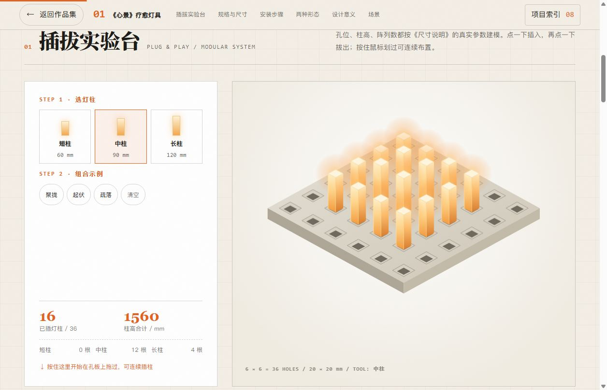
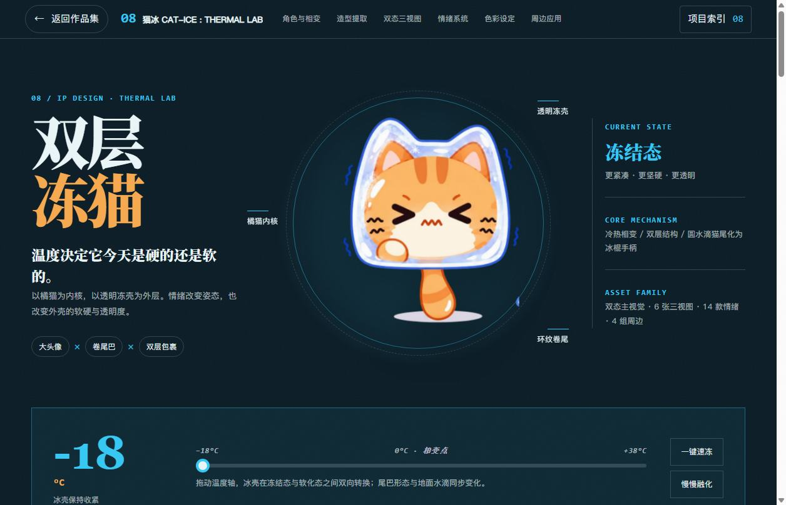
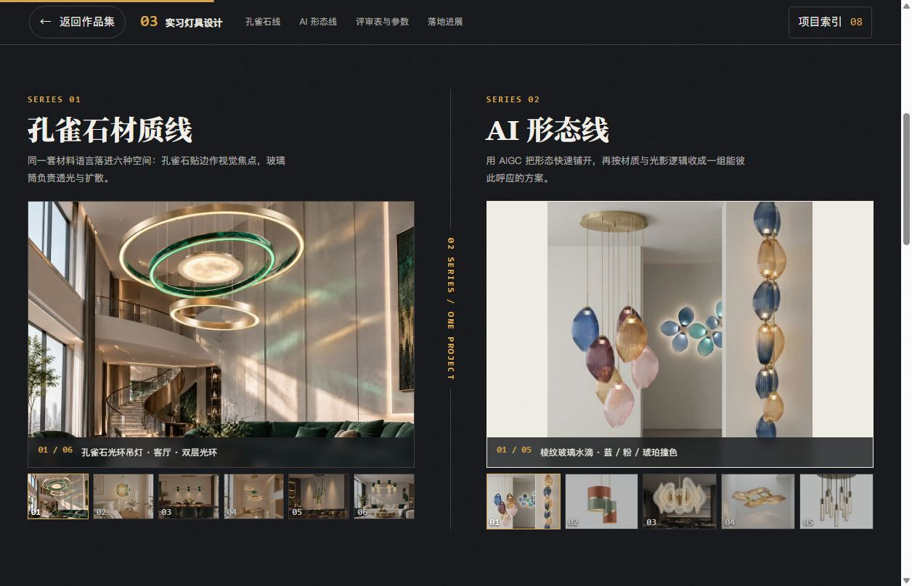
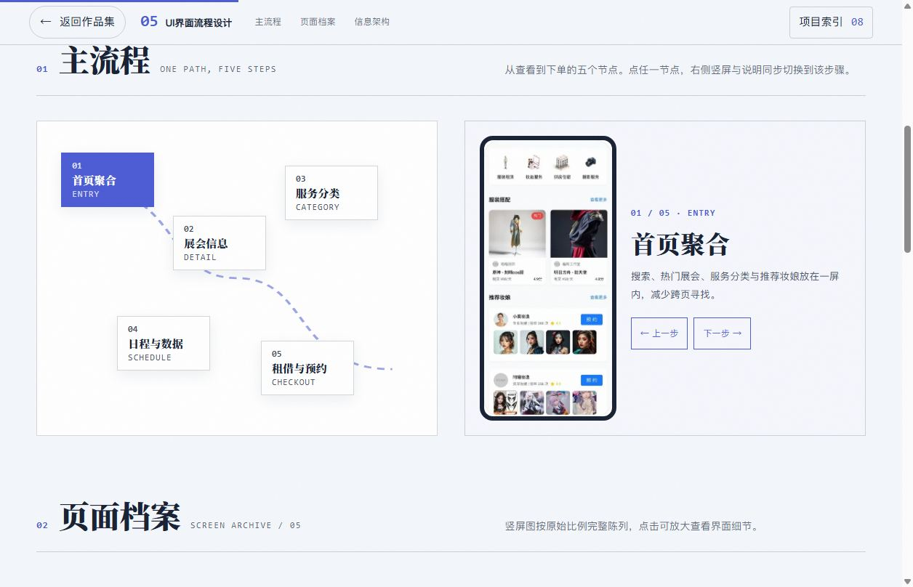
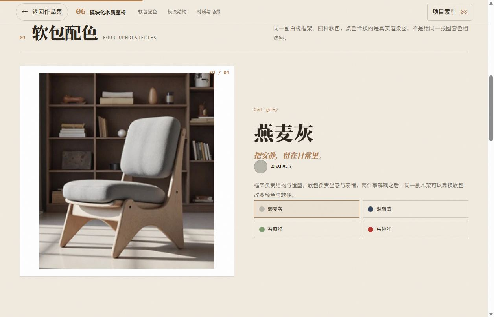

# 8 个项目页面重构 · 素材归类、结构设计与验证

依据要求，先把 206 张素材逐张看过（15 张分组联系表 + 关键原图放大），确认每张图在对应项目里的实际用途、视觉主体、功能分区与版式层级，再按产品形态重做页面。八个页面**没有共用段落模板**：各自的分区顺序、专属装置、配色与栅格都不同。构建通过，桌面 1256×808 与手机 414×896/DPR2 共 16 场景逐项目实测。

## 一、逐张读图后，素材被分成四种身份

| 身份 | 代表文件 | 在页面里的处理方式 |
| --- | --- | --- |
| **RGBA 透明底独立元素** | `cat-ice/character/frozen.webp`、`melted.webp`、`views/*` 6 张、`emotions/01–14`、`merch/01–04`、`chair/chair-cutout.webp` | 当作可自由排布的「角色 / 产品元素」，直接叠在展台、圆形局部放大、情绪网格上；不铺整张图 |
| **已排好版的整张展板** | `project-lamp-1…7`、`lamp-gallery-1…6`、`project-ip-1…4`、`project-ui-1…3`、`project-aigc-*`、`project-ailamp-*`、`project-furniture-*`、`cat-ice/scheme1/*`、`aigc/aigc-board.webp` | **拆出区域语义后用网页原生重排**，只在页尾以小索引保留原板可放大，不作为主体 |
| **产品成品 / 场景照** | `xinjing/user-01…05`、`lamps/01…06`、`lamps/ai/*`、`lamps/grad/*`、`chair/scene-*`、`snail/snail-6*`、`ui-cos-1…4` | 保持原始亮度与比例，按各页自己的叙事节奏排；竖屏 UI 一律 `contain` 不裁切 |
| **过程 / 图纸 / 证据** | `xinjing/fig09–31`、`fig18 尺寸说明`、`qimu/*`、`diemu/*`、`snail/sketch-*`、`snail/mechanism.webp` | 归入推导时间轴、规格标注、资料索引；线稿不冒充主视觉 |

**已排好的区域逻辑（保留语义，不照抄版面）**

- 心景毕设展板：`封面《心景》 → 选题意义 → 方案设计 → 全套演示 → 单独演示 → 设计意义`，另有《模块化设计》单页把内容切成 **产品组成 / 安装步骤 / 灯柱类型 / 组合示例** 四区；`fig18 尺寸说明` 分「灯柱尺寸」与「底座尺寸」两栏。
- 猫冰《角色设定稿》：左为角色大图 + 三处引线（透明冻壳 / 橘猫内核 / 环纹卷尾），右为**双态 × 正侧背**三视图，底部三栏为**造型提取 / 情绪温度 / 色彩设定**；《表情与动作》是 2×4 带名称网格；《周边应用》是 6 格带编号分类。
- UI 展板：多部手机屏并置 + 竖屏流程稿；AIGC 总览板：六格概念；AI 灯具 / 家具展板：图文分区 + 橙色强调块。
- 座椅 `structure.webp`：坐垫模块 / 靠背模块 / 一体化实木框架（内侧面即导轨面）/ 插入方向，四个标注区。

**同类项目之间的布局关联**：01 与 04 同属「光」，但 01 是工程制图台的插拔建模，04 是以手部动词为索引的展板；03 与 04 同属灯具，03 采用左右对开的双系列图录，04 采用 3/3 + 2/2/2 非等宽切分；05 与 07 都用网格，05 是带连线的流程路径，07 是可展开的六概念档案；02 与 06 都有「机构」，02 是横向进度轨道，06 是色卡换色 + 拆解手风琴。八个页面的 `section` 类名序列两两不同（实测 8/8）。

## 二、八个页面各自的结构与专属装置

| 项目 | 分区顺序（自上而下） | 专属功能区域 / 装置 | 视觉系统 |
| --- | --- | --- | --- |
| 01 心景 | 首屏 → **插拔实验台** → 规格与尺寸 → 安装步骤 → 四项功能 → 两种形态 → 设计意义 → 场景序列 | 6×6 等距孔板，点按 / 拖过插入三档真实规格发光柱，实时统计已插数、柱高合计、柱型分布；三种组合预设 | 暖纸网格 + 展板橙 + 琥珀光，工程标本照 |
| 02 慢行者 | 首屏 → **进度轨道** → 四阶段 → 机构与三视图 → 草图时间轴 | 进度滑块联动屏幕数字条、蜗牛沿轨道位置与四阶段高亮；阶段卡可反跳进度 | 冷灰绿 + 仪表台，二重「屏幕 / 桌面」对照 |
| 03 实习灯具 | 全幅主视觉 → **左右对开图录** → 评审表与参数 → 落地进展 | 孔雀石线与 AI 形态线各一套独立主图 + 缩略条，互不干扰 | 墨黑 + 香槟金，中间一条竖分界 |
| 04 情绪疗愈灯具 | 首屏 → **七动作索引 + 主舞台** → 动作展板 → 材质与状态 | 七个手部动词切换真实成果图，主舞台含副图与上一盏 / 下一盏；3/3 + 2/2/2 非等宽展板 | 暖米纸 + 陶土橙 + 3px 硬边 |
| 05 UI 流程 | 首屏竖屏阶梯 → **服务路径** → 页面档案 → 信息架构 | SVG 连线串起五节点，点节点切换对应竖屏与说明；五张竖屏完整陈列 | 冷白 + 靛蓝，手机屏 contain 不裁切 |
| 06 模块化座椅 | 透明底单品首屏 → **软包配色台** → 模块结构 → 材质与场景 | 四色卡切换真实渲染图与采样色值；三条拆解手风琴；结构图可放大 | 奶油 + 焦糖宋体杂志式 |
| 07 概念设计 | 六图拼贴首屏 → **六概念网格** → 在地文化 → 五步流程 | 概念卡展开 lead / 说明 / 规格；五步手风琴带百分比条 | 墨黑网格底 + 橙，产品图保持原亮度 |
| 08 猫冰 | **角色圆形展台** → 温度控制台 → 机制四条 → 造型提取 → 双态三视图 → 情绪系统 → 色彩设定 → 周边应用 → 原板索引 | −18°C→+38°C 温度轴驱动双态真实角色切换；三视图 tab、14 情绪跨格网格、5 色票、6 类周边 | 深蓝夜 + 极光蓝 + 杏橘，IP 官网感 |

## 三、两个指定要求的落点

**心景 · 围绕「插拔」**：不是把图调暗，而是按 `fig18` 的真实参数（短 60 / 中 90 / 长 120 mm、截面 20×20 mm、底座 200×200×45 mm、6×6 共 36 孔、孔径 20×20 mm、亚克力）用 SVG 建了一个等距孔板。柱体有顶面 / 左右侧面渐变、顶部径向光晕，插入与拔出都有状态变化。原展板四区被翻译成网页区域：产品组成＝孔板与柱型，安装步骤＝取柱 / 插入 / 发光三图，灯柱类型＝三种柱高工具，组合示例＝聚拢 / 起伏 / 疏落三预设。首屏主视觉用 `fig30` 成品照保持原有暖光，不做任何全局压暗。

**猫冰 · 以核心 IP 元素为页面重点**：`hero.webp`（网页截图）与三张 `scheme1` 整版展板都退到「资料索引」的小卡。首屏主角是 RGBA 透明底的冻结态 / 软化态角色，置于圆形展台，配三处引线标注；切换状态用两套真实角色图互斥，不用亮度滤镜。设定稿的三栏语义拆成页面里的造型提取（角色局部放大圆）、双态三视图、情绪系统（14 款）、色彩设定（5 个色值从展板色票逐点采样：杏橘 `#FEC37F` / 蜜橙 `#ED965F` / 奶白 `#FFF0DE` / 雾紫 `#8D8CAF` / 深棕 `#5B3C3E`）、周边应用（6 类）。表情名称前 8 条按原展板转录，其余按素材编号稳妥标注，不臆测情绪。

## 四、关于「补充生图 / Blender 建模」的判断

用户允许 AI 生图或用 Blender 补缺。逐张核查后的结论是**八个项目的核心视觉素材并不缺**：心景有成品、孔板、尺寸图、场景与打样过程；猫冰有完整透明底角色资产（双态、6 张三视图、14 表情、4 组周边）；其余六项各有成品图、线稿与已排版展板。若生成新的产品图，反而会引入与实物不符的形态，与「贴合素材用途和产品设计意图、不臆测」相冲突。

因此「必要的建模」改以**网页内建模**完成：01 的 6×6 等距孔板与三档发光柱用 SVG 参数化绘制（可按真实毫米规格插拔），05 的服务路径用 SVG 连线，08 的圆形展台与局部放大用 CSS。不新增任何冒充产品的生成图，也不改动原始素材文件。

## 五、验证结果

| 指标 | 结果 |
| --- | --- |
| 构建 | `vite build` 通过 |
| 场景 | 桌面 8 + 手机 8 = **16/16** 全部渲染成功 |
| 结构差异 | 8 页 `section` 序列 **8/8 互不相同** |
| 坏图 | 每页 8–28 张图，**0 坏图**（全部改 eager 后统计） |
| 横向溢出 | `scrollWidth = clientWidth`，桌面 / 手机均 **0** |
| 触控与字阶 | <44px 控件 **0**；<12px 文本节点 **0** |
| 运行时异常 | **0** |
| 交互实测 | 01 插拔 16→17 根且切到长柱、02 进度 80% 同步、03 右侧换「音浪波浪灯」、04 切「负空间圆环灯」、05 切「日程与数据」、06 换「苔原绿」、07 展开 3 条规格、08 −18→+38 切软化态，全部通过 |
| 四条指定口径 | 逐页保留；全站「功能均可实现」每页仅 1 处 |
| 动效降级 | `prefers-reduced-motion` 下项目页内动画数 **0**，内容全部可见（首页原有滚动提示在详情页之外，不属本次改造） |
| 单页可见中文 | 810–1379 字，信息密度高于上一版且未回到文字堆砌 |

## 六、改动文件

- 新增 `src/components/projectPages/`：`index.jsx`（分发 + 共享外壳）、`shared.jsx`、`meta.js`、8 个 `Pxx*.jsx` 独立页面、`projectPages.css` / `pages.css` / `pages-b.css`（三套样式层）。
- 改 `src/App.jsx`：详情分发从单一 `ProjectShowcase` 换成 `ProjectPages`，沿用 `key={id}` 与深链 `#p=xx`；旧的 `ProjectShowcase` / `ProjectDossier` 文件保留不挂载，便于回退对比。
- 交付：`8页重构证据/` 12 张截图、本文件与同名 HTML。原始指标在 `.workbuddy/tmp/evidence-pages/metrics.json`，验证脚本 `cdp-pages.mjs` / `cdp-sections.mjs`。

## 七、假设与边界

- 论文文件名标注「二次修改中」，尺寸与调研数据按当前版本原文转录；`fig18` 数值直接用于建模，未重新计算。
- 03 的两张评审表扫描件不在站点素材内，参数来自文字转录；手写型号与日期仍只作「扫描件标注」，不作确定参数。
- 02 / 04 / 05 / 06 / 07 / 08 未附落地确认资料，页脚按资料层的稳妥表述，不推断量产或上市状态。
- 未实测真机横滑帧率、弱网大图首屏耗时、读屏器与纯键盘 Tab 走查；截图无法呈现交互，已在验证表中以交互实测逐条说明。
- 静态展示包 `项目展示板块-改版.html` 与两个 `作品集-AI评审包*.zip` 是更早版本的快照，与本轮八个页面无关；若要给 Gemini 重新评分，需按当前新版重做静态包。

